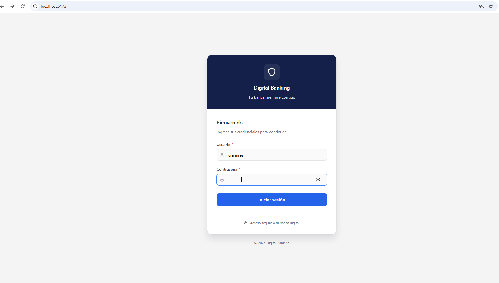
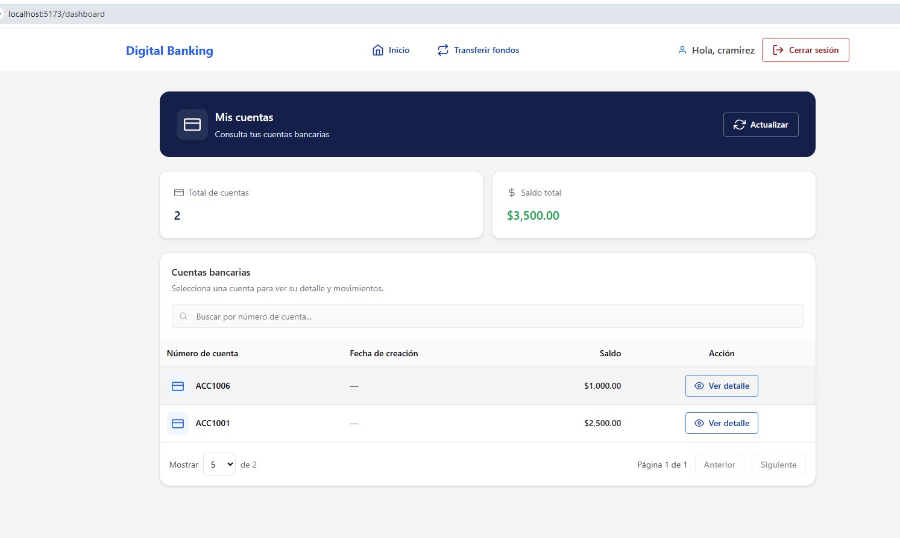
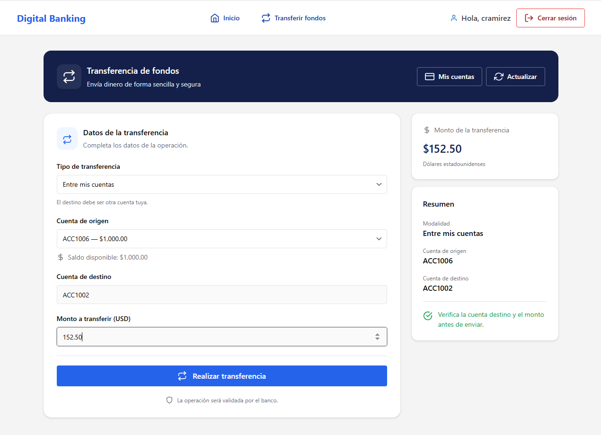

# Digital Banking — Frontend

Aplicación web de banca digital desarrollada con **React**, orientada a ofrecer una interfaz intuitiva para la autenticación de usuarios, consulta de cuentas bancarias y visualización de información financiera.

El frontend consume servicios REST de una API desarrollada con ASP.NET Core, manteniendo separadas las responsabilidades de presentación, comunicación con el backend y lógica de cada funcionalidad.

## 📸 Capturas de pantalla

### Inicio de sesión



### Dashboard



### Detalle Cuentas bancaria


### Transferencias bancarias



> Las capturas deben corresponder a la aplicación real. Si alguna funcionalidad todavía está en desarrollo, omite su imagen hasta que esté disponible.

## ✨ Funcionalidades

- **Autenticación:** formulario de inicio de sesión y comunicación con el servicio de autenticación.
- **Dashboard:** punto de entrada para consultar la información principal de la aplicación.
- **Cuentas bancarias:** consulta y presentación de información de las cuentas.
- **Integración con API REST:** consumo de endpoints del backend.
- **Manejo de estados:** gestión de datos, carga y errores en los componentes.
- **Interfaz de usuario:** componentes reutilizables y diseño adaptable a distintos tamaños de pantalla.

## 🛠️ Tecnologías

- **React** — construcción de interfaces de usuario.
- **Vite** — entorno de desarrollo y compilación.
- **JavaScript / TypeScript** — lógica del frontend, según los archivos implementados.
- **Chakra UI** — componentes visuales, si se mantiene como biblioteca de interfaz.
- **Fetch API** — comunicación HTTP con el backend.

## 🏗️ Arquitectura del proyecto

El frontend organiza el código por funcionalidades para facilitar su mantenimiento y evolución.

```text
src/
├── app/
├── features/
│   ├── auth/
│   │   ├── components/
│   │   ├── context/
│   │   ├── pages/
│   │   └── services/
│   ├── accounts/
│   │   ├── components/
│   │   ├── pages/
│   │   └── services/
│   └── dashboard/
├── services/
│   └── apiClient.js
├── shared/
│   ├── components/
│   └── utils/
├── App.jsx
└── main.jsx
```

> Esta estructura es una referencia. Ajusta el árbol a las carpetas reales del repositorio.

### Separación de responsabilidades

- **`features/`:** componentes, páginas y servicios propios de cada módulo.
- **`services/apiClient`:** configuración centralizada de las solicitudes HTTP.
- **`shared/`:** componentes y utilidades reutilizables.
- **`app/`:** configuración general de la aplicación, como rutas y proveedores.
- **`App`:** composición principal de la interfaz.

## ⚙️ Requisitos previos

- Node.js y npm.
- Acceso a la API de Digital Banking.
- Git.

## 🚀 Instalación y ejecución

### 1. Clonar el repositorio

```bash
git clone <URL_DEL_REPOSITORIO_FRONTEND>
cd <CARPETA_DEL_FRONTEND>
```

### 2. Instalar dependencias

```bash
npm install
```

### 3. Configurar la URL de la API

Crea un archivo `.env` en la raíz del proyecto:

```env
VITE_API_URL=https://localhost:7050/api/v1
```

Sustituye la URL por la dirección real del backend. Si el proyecto usa HTTPS local, asegúrate de que el certificado de desarrollo sea confiable para el navegador.

### 4. Iniciar el servidor de desarrollo

```bash
npm run dev
```

Vite mostrará en la terminal la dirección local para abrir la aplicación en el navegador.

### 5. Generar la versión de producción

```bash
npm run build
```

Para probar localmente el resultado de la compilación:

```bash
npm run preview
```

## 🔌 Integración con DigitalBankingAPI

Este proyecto frontend consume los servicios REST de **[DigitalBankingAPI](https://github.com/iagamaliel/DigitalBankingAPI)**, una API desarrollada con ASP.NET Core que proporciona las funcionalidades y el acceso a los datos de la aplicación de banca digital.

Para ejecutar la aplicación completa, es necesario tener configurado y en ejecución el backend.

### Base de datos y datos de prueba

El repositorio **DigitalBankingAPI** incluye scripts SQL para crear y poblar la base de datos con datos de prueba, facilitando la configuración del entorno de desarrollo y la validación de las funcionalidades del frontend.

Consulta el repositorio del backend para acceder a los scripts y seguir las instrucciones de configuración correspondientes.

### Usuarios de pruebas:
Username: cramirez, password:Demo123*
Usename:  mlopez, password:Demo123*

## 📁 Capturas de pantalla

Guarda las imágenes del proyecto en esta carpeta:

```text
docs/
└── images/
    ├── login.png
    ├── dashboard.png
    └── accounts.png
```

## 📌 Estado del proyecto

Proyecto en desarrollo.

## 👨‍💻 Autor

**Caleb Salazar**

Desarrollador Senior .NET | React | ASP.NET Core | SQL Server
